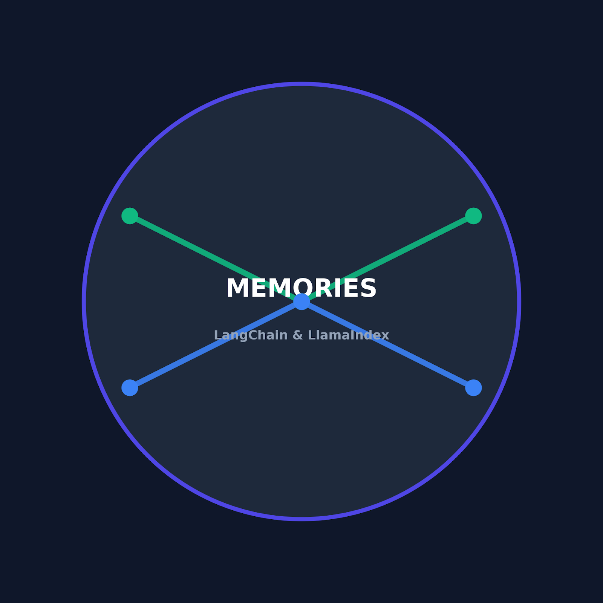

<p align="center">
  
</p>

<h1 align="center">Memories con LangChain y LlamaIndex</h1>

<p align="center">
  <a href="https://www.python.org/"></a>
  <a href="https://github.com/langchain-ai/langchain"></a>
  <a href="LICENSE"></a>
  <a href="https://colab.research.google.com/github/juandelaf1/memories-langchain-llamaindex/blob/main/notebooks/02_Demo_Memories_Solucion.ipynb"></a>
  <a href="#-demo-en-vivo-con-streamlit"></a>
</p>

<p align="center">Píldora <b>«Orquestación de flujos con LangChain/LlamaIndex: Memories»</b> — 60 minutos.</p>

## Recorridos

| | **Recorrido A — clase sencilla** (recomendado) | **Recorrido B — demo técnica** (opcional) |
|---|---|---|
| Para quién | Para impartir la clase sin fricción (compañeros y alumnado) | Para quien quiera ver el LLM real |
| Cómo | Notebooks **sin API key**: modelo determinista simulado claramente identificado | Notebook 02 **con** `GROQ_API_KEY` (nivel gratuito) |
| Qué usa | La memoria es **real** (LangGraph `checkpointer` + `thread_id`); solo se simula el texto del LLM | Lo mismo + LLM real de Groq |
| Requisitos | Ninguno: sin cuentas, sin claves, sin GPU, sin coste | Cuenta de [Groq](https://console.groq.com/keys) |

Ambos recorridos comparten el **mismo notebook 02**: al ejecutarlo, si detecta una clave entra en modo con API; si no, en modo sin API. El reto (`03`/`04`) no necesita clave nunca.

## Objetivo

Al terminar la sesión, el alumnado sabe explicar y demostrar:

1. Por qué una aplicación necesita gestionar el contexto para mantener la continuidad entre llamadas a un LLM (las llamadas son *stateless*).
2. La diferencia entre **historial conversacional**, **memoria a corto plazo** (sesión/*thread*) y **memoria persistente** (entre sesiones).
3. Cómo se guarda, recupera e inspecciona el historial de una conversación con LangChain (`create_agent` + `checkpointer=InMemorySaver()` + `thread_id`).
4. Cómo evitar que dos sesiones compartan accidentalmente su contexto (un `thread_id` por conversación).
5. Límites, costes y riesgos de esa memoria (ventana de contexto, coste por token, datos sensibles, borrado).

Comparación **conceptual** con LlamaIndex (`Memory`, memoria a corto y largo plazo). No se tocan RAG, embeddings, chunking ni bases vectoriales: esos temas pertenecen a otras píldoras del itinerario. LlamaIndex **no se instala ni se ejecuta**.

## Prerrequisitos

- **Nivel:** saber Python básico y haber usado un chatbot con LLM.
- **Cuenta:** ninguna para el Recorrido A. Para el Recorrido B, opcionalmente una API key de **Groq** (nivel gratuito) o **OpenAI** (de pago).
- **Instalación:** los notebooks instalan ellos mismos las dependencias fijadas (ver `requirements.txt`). No hace falta instalar nada previamente.
- **Tiempo de la actividad:** el reto dura 10-20 minutos.

## Estructura del repositorio

```
memories-langchain-llamaindex/
├── README.md                                  ← este archivo
├── LICENSE                                    ← MIT
├── requirements.txt                           ← versiones probadas (+ streamlit, opcional)
├── app.py                                     ← demo interactiva con Streamlit
├── assets/
│   ├── memories.png                            ← logo del material (README)
│   └── logo.svg                                ← logo vectorial (app Streamlit)
├── slides/
│   ├── 01_Memories.pptx                       ← presentación (editable, con notas del ponente)
│   └── 01_Memories.pdf                        ← presentación (versión de reparto)
├── notebooks/
│   ├── 02_Demo_Memories_Solucion.ipynb        ← demo del formador (con o sin API)
│   ├── 03_Reto_Memories_Alumno.ipynb          ← reto del alumnado (Recorrido A, con tests)
│   └── 04_Reto_Memories_Solucion.ipynb        ← solucionario (mismos tests)
└── docs/
    ├── plan_de_clase.md                       ← guion minutado de los 60 minutos
    ├── rubrica.md                             ← 4 criterios = 4 tests
    ├── criterio_etico.md                      ← ficha de criterio ético
    └── troubleshooting.md                     ← errores frecuentes y soluciones
```

## Entregables

| Entregable | Archivo |
|------------|---------|
| Presentación (reparto) | [`slides/01_Memories.pdf`](slides/01_Memories.pdf) |
| Presentación (editable) | [`slides/01_Memories.pptx`](slides/01_Memories.pptx) |
| Notebook del formador | [`notebooks/02_Demo_Memories_Solucion.ipynb`](notebooks/02_Demo_Memories_Solucion.ipynb) |
| Notebook del alumnado | [`notebooks/03_Reto_Memories_Alumno.ipynb`](notebooks/03_Reto_Memories_Alumno.ipynb) |
| Solucionario del reto | [`notebooks/04_Reto_Memories_Solucion.ipynb`](notebooks/04_Reto_Memories_Solucion.ipynb) |
| App interactiva (Streamlit) | [`app.py`](app.py) |
| Plan de clase y guion | [`docs/plan_de_clase.md`](docs/plan_de_clase.md) |
| Rúbrica (corrección automática) | [`docs/rubrica.md`](docs/rubrica.md) |
| Criterio ético | [`docs/criterio_etico.md`](docs/criterio_etico.md) |
| Troubleshooting | [`docs/troubleshooting.md`](docs/troubleshooting.md) |

## Abrir los notebooks en Google Colab

Colab no puede ejecutar notebooks que solo están en tu disco: súbelos al repositorio en GitHub o arrástralos a [colab.research.google.com](https://colab.research.google.com).

Si el repositorio está publicado en GitHub, los botones abren directamente cada notebook:

| Notebook | Abrir en Colab |
|----------|----------------|
| Demo del formador | [](https://colab.research.google.com/github/juandelaf1/memories-langchain-llamaindex/blob/main/notebooks/02_Demo_Memories_Solucion.ipynb) |
| Reto del alumnado | [](https://colab.research.google.com/github/juandelaf1/memories-langchain-llamaindex/blob/main/notebooks/03_Reto_Memories_Alumno.ipynb) |
| Solucionario | [](https://colab.research.google.com/github/juandelaf1/memories-langchain-llamaindex/blob/main/notebooks/04_Reto_Memories_Solucion.ipynb) |

> Si el repositorio vive en otra cuenta o tiene otro nombre, cambia `juandelaf1/memories-langchain-llamaindex` en los enlaces anteriores.
> Alternativa sin GitHub: en Colab, *Archivo → Subir notebook* y el elige el archivo `.ipynb`.

## Ejecutar la demo

### Recorrido A — sin API (recomendado)

1. Abre `02_Demo_Memories_Solucion.ipynb` en Colab y haz **Runtime → Run all**.
2. Sin ninguna clave, la celda de entorno imprime `Modo: SIN API (demo determinista)` y la demo continúa igual.
3. Lo que se demuestra es idéntico al Recorrido B: **el guardado, la recuperación, el aislamiento y el borrado los hace LangChain/LangGraph** (`InMemorySaver` + `thread_id`); solo está simulada la generación del texto del LLM (clase `ModeloDeterminista`, identificada como tal en el notebook).
4. El notebook imprime además un **mapa del almacén** (una fila por hilo con sus mensajes) para ver el aislamiento sin leer código.

Sirve para preparar la sesión, para quien no tenga clave y para ejecutar el notebook de principio al fin sin coste.

### Recorrido B — con API (opcional, LLM real)

1. Consigue una clave: [console.groq.com/keys](https://console.groq.com/keys) (nivel gratuito) o [platform.openai.com/api-keys](https://platform.openai.com/api-keys).
2. En Colab: icono de candado en la barra lateral izquierda → **Secrets** → *Add secret* → nombre `GROQ_API_KEY` (o `OPENAI_API_KEY`) → pega el valor. **Nunca** pegues la clave en una celda ni la subas al repositorio.
3. Abre `02_Demo_Memories_Solucion.ipynb` y haz **Runtime → Run all**. El mismo notebook detecta la clave e imprime `Modo: CON API` y el proveedor.
4. Las celdas que generan texto con el modelo están marcadas con la nota «Con API → LLM real · Sin API → modelo determinista».

La demo realiza **4 llamadas cortas** al modelo con un prompt de sistema que limita la respuesta a ~60 palabras: coste residual (en Groq, nivel gratuito). Revisa siempre la tarifa de tu proveedor; el historial completo se reenvía en cada turno, así que en conversaciones largas el coste crece.

```bash
# Ejecución local equivalente (sin pasar por Colab)
pip install -r requirements.txt
jupyter nbconvert --to notebook --execute notebooks/02_Demo_Memories_Solucion.ipynb
```

## Completar y corregir la actividad (reto)

1. El alumnado abre `03_Reto_Memories_Alumno.ipynb` en Colab (**no necesita API keys, cuentas ni GPU**: el reto no usa modelo).
2. Implementa **3 funciones** con `TODO` (pistas progresivas en desplegables): `guardar_mensaje`, `obtener_historial`, `borrar_sesion`.
3. **Runtime → Run all**. La última celda imprime el resultado:
   - `🎉 ¡TODAS LAS PRUEBAS SUPERADAS! (4/4)` → superado.
   - `❌ n/4 pruebas fallidas` → cada línea indica el test y el motivo del `assert`.
4. La rúbrica es literalmente esa salida: 4 tests = 4 criterios (`docs/rubrica.md`). No se corrige nada más a mano.
5. El formador tiene `04_Reto_Memories_Solucion.ipynb` con los **mismos tests** resueltos y comentados.

## Demo en vivo con Streamlit

La app `app.py` reproduce la clase en el navegador: chat con memoria real, selector de sesiones (aislamiento), borrado de una sesión, mapa del almacén y pestañas con el reto y el material.

```bash
pip install -r requirements.txt   # incluye streamlit==1.56.0
streamlit run app.py              # abre http://localhost:8501
```

- **Sin clave** usa el mismo `ModeloDeterminista` (Recorrido A). Si exportas `GROQ_API_KEY` en la terminal antes de arrancar, usa el LLM real (Recorrido B).
- La memoria vive en la RAM del proceso: al reiniciar la app el historial empieza de cero (como en los notebooks).

## Documentación oficial consultada

- LangChain — visión general de memoria: <https://docs.langchain.com/oss/python/concepts/memory>
- LangChain — memoria a corto plazo (`create_agent` + checkpointer): <https://docs.langchain.com/oss/python/langchain/short-term-memory>
- Referencia — `RunnableWithMessageHistory`: <https://reference.langchain.com/python/langchain-core/runnables/history/RunnableWithMessageHistory>
- LangChain — memoria a largo plazo (stores): <https://docs.langchain.com/oss/python/langchain/long-term-memory>
- LlamaIndex — ejemplo de `Memory`: <https://developers.llamaindex.ai/python/examples/memory/memory/>
- LlamaIndex — memoria de agentes: <https://developers.llamaindex.ai/python/framework/module_guides/deploying/agents/memory/>

## Enlaces internos rápidos

- ¿Algo falla? → [`docs/troubleshooting.md`](docs/troubleshooting.md)
- ¿Cómo impartirla? → [`docs/plan_de_clase.md`](docs/plan_de_clase.md)
- ¿Qué datos podemos guardar? → [`docs/criterio_etico.md`](docs/criterio_etico.md)
- ¿Licencia del material? → [`LICENSE`](LICENSE) (MIT)
